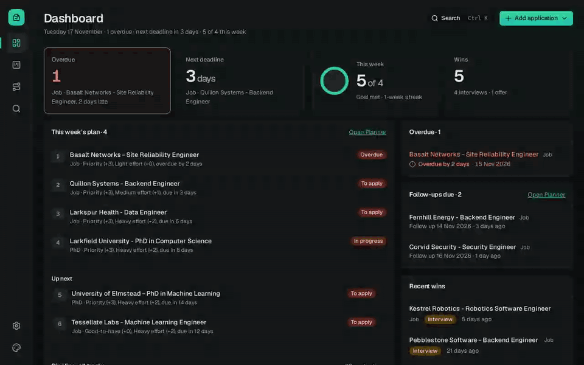
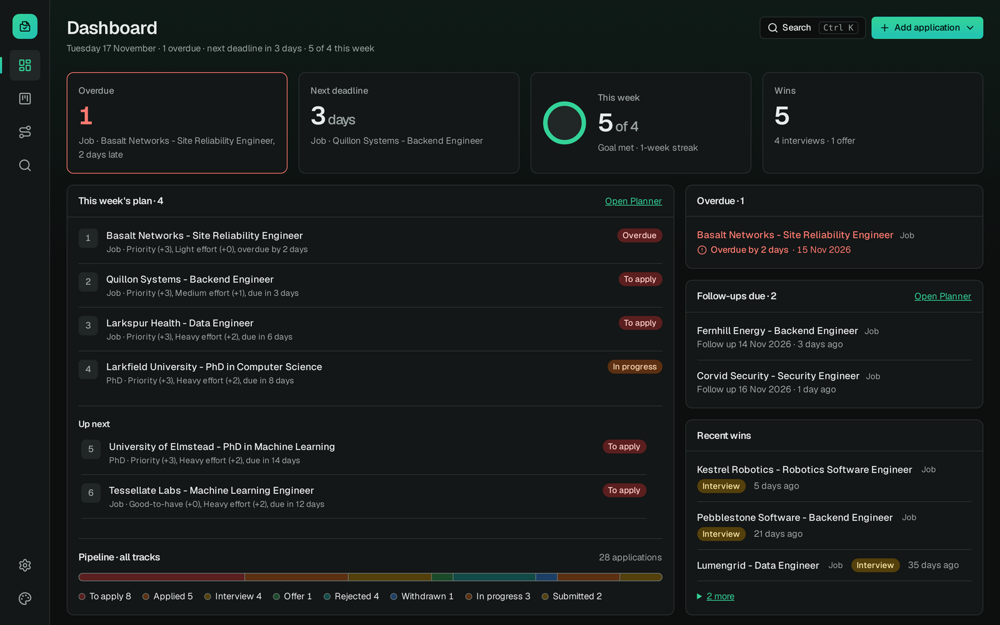
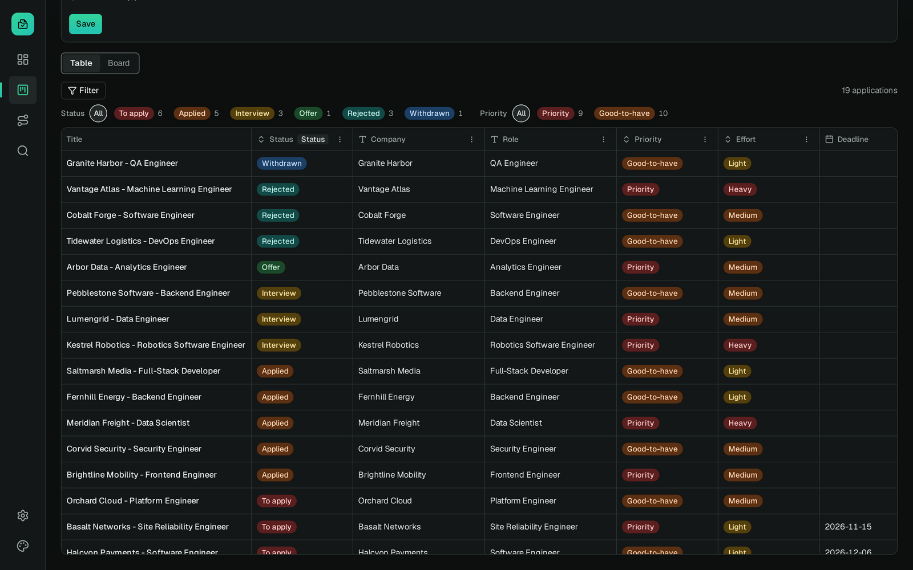
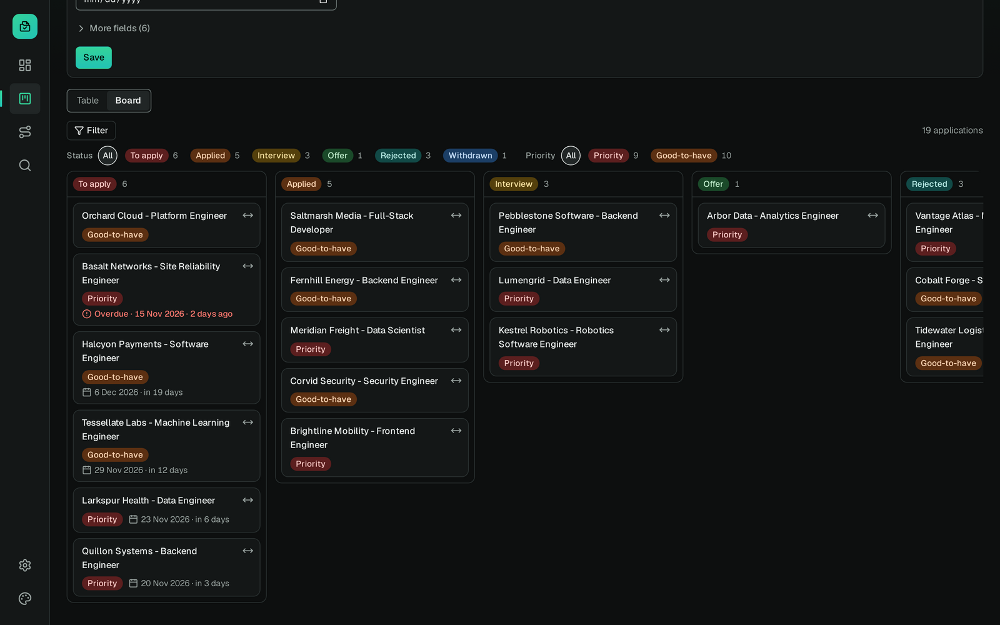
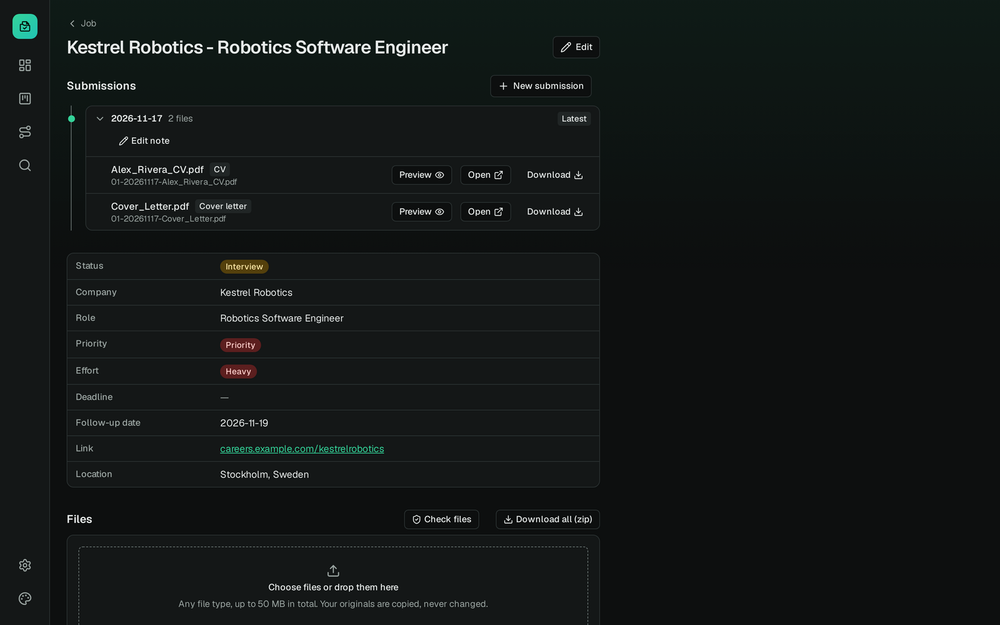
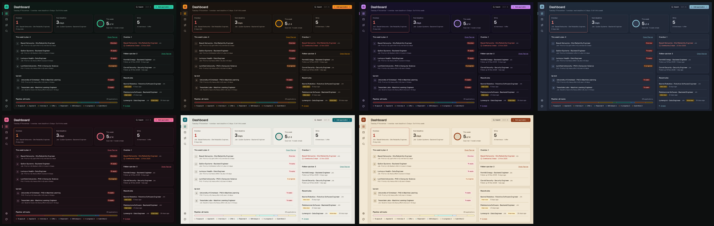
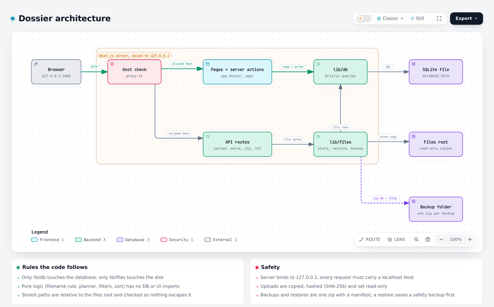

# Dossier

A local-first tracker for job and PhD applications that keeps the exact files you sent.

Add an application, attach your CV and cover letter, and record a submission when you send it. Months later, when a recruiter calls back, open the application and the exact files you sent are one click away: not "CV_final_v3_really_final.pdf", but the copy that went to that company on that day.

> **Version 0.1.0.** Dossier is a single-user app that runs on your own computer. There are no accounts, no sync and no cloud. It is usable every day, and it does not try to be a hosted product. Read [Not implemented yet](#not-implemented-yet) and [Known issues](#known-issues) before you start.



<table>
  <tr>
    <td align="center">
      <br>
      Dashboard
    </td>
    <td align="center">
      <br>
      Track table
    </td>
  </tr>
  <tr>
    <td align="center">
      <br>
      Board view
    </td>
    <td align="center">
      <br>
      Application and its submission
    </td>
  </tr>
</table>

All screenshots use made-up demo data.


## Why this exists

When you apply to many jobs or PhD programmes at once, the spreadsheet holds the status and a folder somewhere holds the files, and the two drift apart. A few weeks later you cannot say which version of the CV went where.

Dossier keeps both in one place. It is built around four ideas:

- **The files are the point.** Every upload is copied, renamed by a fixed rule, hashed (SHA-256) and set read-only. A submission records exactly which files went out and when.
- **Local-first.** One SQLite file and one folder of files on your own disk. No account, no telemetry and no network calls to third parties. The server only answers on `127.0.0.1`.
- **Your columns, not mine.** Tracks, columns and statuses are data you edit in the app. A PhD track can have Supervisor and Funding columns; a job track can have Location and Effort. No code change is needed for either.
- **Nothing is lost quietly.** Every destructive action confirms and says what will be lost. Backups are one zip, and a restore saves a safety backup first.


## What works today

| Feature | How to use it |
|---|---|
| Tracks | Start from the Job or PhD template or a blank track. Rename, recolour, star or delete tracks on the **Tracks** page |
| Flexible columns | Text, number, date, link, checkbox and single-select columns. Add, rename, hide, reorder; edit the options and their colours |
| Table view | Edit cells in place, sort by any column, filter by any single-select column. Scrolls smoothly with hundreds of rows |
| Board view | One column per status. Drag a card to change its status, or use the keyboard (Space, arrows, Space) or the card's **Move to** menu |
| File uploads | Drop files on an application. Each one is labelled (CV, Cover letter, SOP, ...) and stored as `NN-YYYYMMDD-name.ext` in a folder for that application |
| Submissions | **New submission** records the date and the files you sent. Dossier warns if a file it expects for that track (for example a CV) is missing |
| Preview and download | Preview a file inside the app, open it in a new tab, download it, or download all of an application's files as one zip |
| File checks | **Check files** compares every stored file with its hash and flags any file changed or missing on disk |
| Notes and history | Add notes to an application. Status changes, uploads and submissions appear on its timeline |
| Search | `Ctrl + K` searches titles, companies, text fields and notes across every track |
| Planner | Ranks what to work on this week by priority, effort, deadline and follow-up date, with the reason for each place. Weekly capacity and rules are in **Planner settings** |
| Dashboard | Overdue items, next deadline, this week's progress and streak, follow-ups due, recent wins, and the pipeline across all tracks |
| Backup and restore | **Back up now** writes one zip with the database and every file. Restore checks the zip first, then replaces your data after a confirmation |
| CSV export | **Export CSV** on a track saves every application in it, archived ones too |
| Themes | Seven themes: Graphite (default), Ember, Amethyst, Glacier and Rosewood (dark), Paper and Sand (light) |
| Database updates | After an update, a **Back up and update** button backs up the database and applies the new schema in one step |

**Keys**

```
Ctrl + K        Search
Ctrl + B        Expand or collapse the sidebar
Ctrl + Enter    Add the note you are typing
Space           On the board: pick up a card, then drop it
← / →           On the board: move a picked-up card to the next column
Esc             Close a dialog, or cancel a drag
```




## Not implemented yet

Listed honestly so you know what you are getting.

- **Contacts.** There is no list of recruiters, professors or referees linked to applications. Use a text column or a note for now.
- **Saved views.** Filters and sort live in the page address. Bookmark the URL to keep a view.
- **Sync or a second user.** Dossier is one person on one computer. Moving to a new computer is a backup and a restore.
- **Import.** There is CSV export, but no CSV import from an existing spreadsheet.


## Known issues

- File preview uses your browser's built-in PDF viewer, so what it shows depends on the browser. **Open** and **Download** always work.
- Board drag and drop on touch screens has had little testing. The **Move to** menu on each card works everywhere.
- A backup interrupted by a crash or power loss leaves an unfinished zip behind. It does not open, and Dossier does not clean it up.


## Requirements

- **Node.js 24 LTS** with npm (22 also works).
- Linux or Windows: CI runs every check on Ubuntu and Windows with Node 24. macOS should work but is not tested.
- With Node 22, 24 or 26, `npm ci` downloads a ready-made binary for the database library, `better-sqlite3`. On another version (Node 20 included) it has to build it, and that needs Python 3 and a C++ compiler (Visual Studio Build Tools on Windows).


## Install and run

```bash
git clone https://github.com/mawaissaleem/dossier.git
cd dossier
npm ci
npm run db:migrate
npm run build
npm run start
```

Open <http://127.0.0.1:3000>.

**First steps in the app**

1. **Settings → Files**: choose the folder where your files will be stored (the files root). It must be an existing folder outside the project folder.
2. **Settings → Backup**: choose a backup folder, then press **Back up now** once.
3. **Tracks → Add track**: pick the Job template, the PhD template or a blank track.

`npm run db:seed` is optional. It adds the Job and PhD tracks in one step and does nothing if you already have a track.

To use another port: `npm run start -- -p 4000`.

**Localhost only.** Always start Dossier with the npm scripts. They bind to `127.0.0.1`. Running `next start` or `next dev` directly listens on every network interface. As a second guard, every request must carry a `localhost`, `127.0.0.1` or `[::1]` Host name; anything else gets `Forbidden: Dossier answers on localhost only.`


## Where your data lives

Everything stays on your machine. Dossier makes no requests to outside services.

| What | Where |
|---|---|
| Database | The file in `DATABASE_PATH`. Default: `data/dossier.db` in the project folder (git ignores `data/`) |
| Files root | The folder you choose in **Settings → Files**. No default: uploads are refused until you choose one |
| Backups | The folder you choose in **Settings → Backup**. No default either |

The repository ships a `.env` file with `DATABASE_PATH=./data/dossier.db`. To keep the database somewhere else, do not edit `.env`. Create `.env.local` (git ignores it) with a full path, then run `npm run db:migrate` again:

```
DATABASE_PATH=/path/to/dossier-data/dossier.db
```

**How files are stored**

- Each application gets its own folder in the files root, named from its first upload: `Company_Role_YYYY-MM` for a job, `University_Program_YYYY-MM` for a PhD. Renaming the company later does not move anything.
- Each file is renamed `NN-YYYYMMDD-name.ext`, for example `01-20261117-cv.pdf`. `NN` counts up per name, date and extension, so an older file is never overwritten.
- Your original is copied, never changed. Stored files are set to read-only. The limit is 50 MB per upload.
- The same file (same SHA-256) is not stored twice for one application.
- Paths are stored relative to the files root and checked on every read, so nothing can point outside it.


## Backup and restore

Open **Settings → Backup**.

**Back up now** writes `dossier-backup-YYYYMMDD-HHMM.zip` into your backup folder. It never overwrites an earlier backup. The zip holds a `manifest.json` (date, schema version, counts), a consistent copy of the database, and every file in your files root with the same relative paths. A banner reminds you when the last backup is older than the reminder interval (7 days by default).

**Restore.** Type the full path of a backup zip and press **Check backup**. Dossier reads it and verifies every file; nothing changes yet. Then **Restore…** shows what you will lose. Dossier saves a safety backup of your current data first, and changes nothing if that fails. To undo a restore, restore the safety backup.

On a new computer: set the files root and the backup folder in Settings, then restore.

**Moving the files folder.** In **Settings → Files**, **Move files…** moves everything into a new empty folder, checking each copy against its hash. **Re-point** is for a folder you already moved yourself: Dossier saves the new path only if every stored file is there.

**Manual fallback.** Stop the server, then copy the database file and the whole files root somewhere safe.


## Updating

```bash
git pull
npm ci
npm run build
npm run start
```

If the new version changes the database, every page says **Your database needs updating**. Press **Back up and update**: Dossier copies the database first, then applies the changes in one transaction. If the copy fails, nothing is changed; if the update fails, the database is left as it was. Dossier never updates an existing database by itself.

From the terminal instead: stop the server, copy the database file somewhere safe, run `npm run db:migrate`, and start again.


## Architecture



The interactive version, with links from each box to its source, is [docs/architecture/architecture.html](docs/architecture/architecture.html) (download it and open it in a browser).

The requirements spec Dossier was built from is [docs/requirements.md](docs/requirements.md); code comments cite its IDs (FR-n, NFR-n, AT-n). It was written before the build, so where the app differs (for example, tracks are now added by the user rather than shipped as Job and PhD), this README describes the app as it is.

```
app/            Pages, server actions (app/actions/) and API routes (app/api/)
├── api/        File upload, file serving, zip download, CSV export, search
├── tracks/     Track table and board
└── applications/  Application page: files, submissions, history
components/     Shared UI (shadcn/ui based)
lib/
├── db/         Every database query (Drizzle + better-sqlite3)
├── files/      Every file-system operation: store, resolve, backup, restore, move
└── *.ts        Pure logic: filename rule, planner scoring, filters, sort, CSV, dates
drizzle/        SQL migrations
proxy.ts        The localhost Host check in front of every request
tests/          Vitest suites
```

Three rules hold throughout:

- Only `lib/db` touches the database and only `lib/files` touches the disk. Pages, components and API routes go through them.
- Pure logic lives in its own modules with no database or UI imports, so it is tested on its own.
- Columns and their values are data (`columns`, `cell_values`), never schema changes. Adding a column in the app does not change a table.

**Upload flow.** The browser posts the files to `/api/applications/<id>/files`. The route checks the Host and the origin, then `lib/files/store.ts` writes each file to a temporary name, hashes it, links it to its final name, removes the temporary name, sets it read-only and only then inserts the database row. A failure part way leaves no half-written file and no row pointing at nothing.

**Reading a file.** `/api/files/<id>` looks up the row, resolves the stored relative path inside the files root (`lib/files/resolve.ts`), checks the hash and serves the bytes. A file that changed on disk gets a warning page with an **Open anyway** link instead.

**Stack.** Next.js (App Router) with TypeScript and Tailwind, SQLite through better-sqlite3 and Drizzle, TanStack Table and Virtual, dnd-kit, archiver, shadcn/ui, Vitest.


## Tests

```bash
npm test
```

117 test files and 1,641 tests cover the filename rule, the planner, filters and sort, CSV export, the database layer and its migrations, uploads and duplicates, path checks (nothing may escape the files root, zip entries included), backup, restore and moving the files folder, the localhost checks, server actions, and colour contrast. Every theme is checked against WCAG AA from the CSS itself, so a colour change that makes text unreadable fails the tests. Tests run against temporary databases and folders, never `data/`.

GitHub Actions runs lint, the type check, the tests and a production build on every push and pull request to `main`.

```bash
npm run lint
npx next typegen && npx tsc --noEmit
npm run build
```


## Performance

Measured on a production build with a test database of 500 applications:

| Measurement | Time |
|---|---|
| Dashboard (`/`) | 61 to 74 ms |
| Tracks page (`/tracks`) | 27 to 46 ms |
| Pipeline across all tracks | about 40 ms |
| From search to the latest submission of an application | 2 clicks, about 1.1 s |

`npm run db:seed:fake -- --count 500` fills a scratch database with fake applications for checks like these. It refuses to write into `data/dossier.db`.


## Troubleshooting

- **`Forbidden: Dossier answers on localhost only.`** Open <http://127.0.0.1:3000> instead of a computer name or proxy.
- **`EADDRINUSE: address already in use`** Another process, often an old Dossier, uses the port. Stop it, or use `npm run start -- -p 4000`.
- **`DATABASE_PATH is not set`** Run the commands from the project folder, or set `DATABASE_PATH` in `.env.local`.
- **`no such table: tracks`** Run `npm run db:migrate`.
- **`Choose the files folder in Settings before uploading.`** Set the files root in **Settings → Files**.
- **A file shows `Changed since upload` or `Missing`.** It was edited, replaced or deleted outside Dossier. Press **Check files** on the application page to recheck all of them.
- **`The files folder was not found.`** If you moved the folder, use **Re-point** in Settings. If the drive is not mounted, mount it and try again.
- **A backup is refused.** The backup folder must exist, be writable, and be outside the project folder, the database folder and the files root.


## Development

This project was built with AI-assisted coding.

```
npm run dev            Development server on 127.0.0.1:3000
npm run build          Production build
npm run start          Production server on 127.0.0.1:3000
npm run lint           ESLint
npm test               Vitest, once (npm run test:watch to watch)
npm run db:migrate     Apply ./drizzle migrations to DATABASE_PATH
npm run db:seed        Optional: add the Job and PhD tracks
npm run db:generate    Generate a migration after editing lib/db/schema.ts
npm run db:seed:fake   Fake applications for a scratch database (--count, --mix, --seed)
```


## Security notes

Dossier holds personal documents, so a few things are deliberate:

- The server binds to `127.0.0.1`, and every request must carry a localhost Host name. That also blocks DNS-rebinding attacks from a web page.
- Uploads and file actions also require a same-origin request.
- A file path from the database is resolved inside the files root and checked. A stored path cannot point outside it, and zip downloads use stored names only.
- Uploaded files are served with `X-Content-Type-Options: nosniff`, and only safe types are shown inline.
- No telemetry and no analytics. Next.js telemetry is switched off in `.env`.

Known gap: there is no login. Anyone who can use your computer account can open Dossier.

Found a security problem? Open an issue, or use the contact on the author's GitHub profile if you would rather not disclose it publicly.


## Licence

MIT. See [LICENSE](LICENSE).
